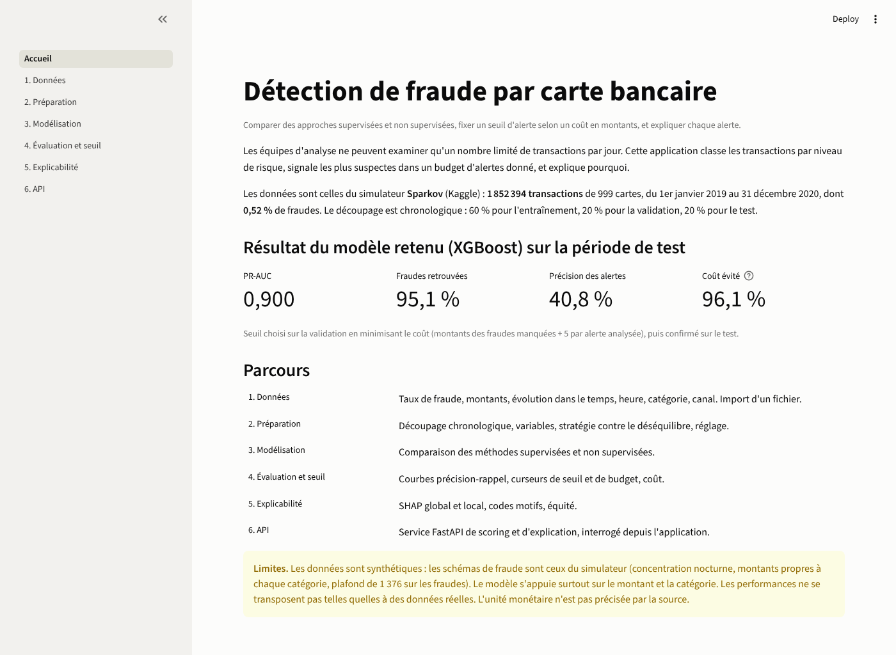
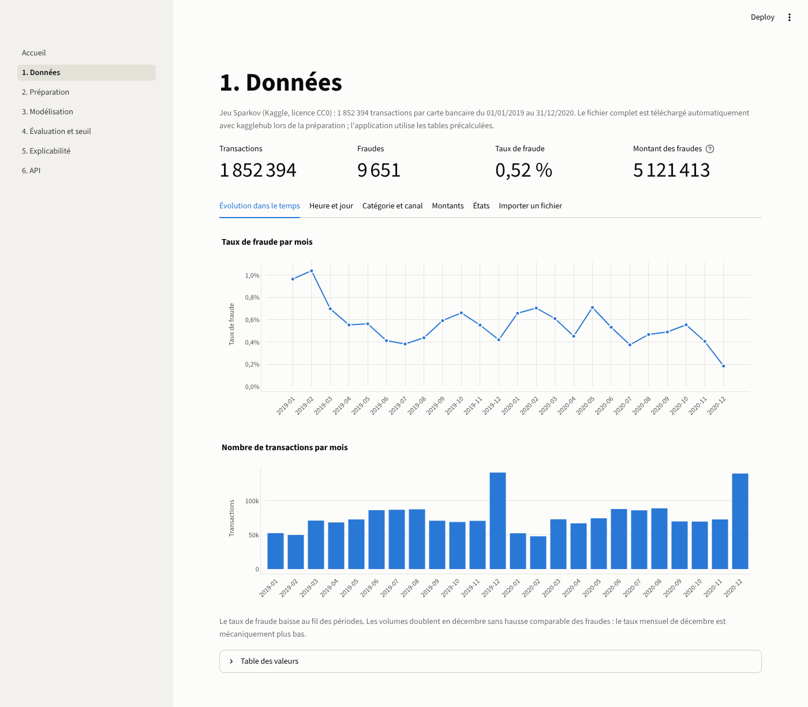
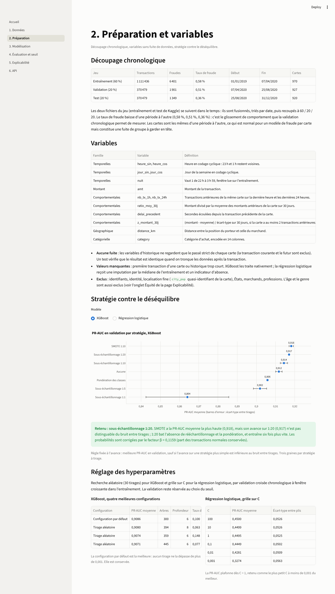
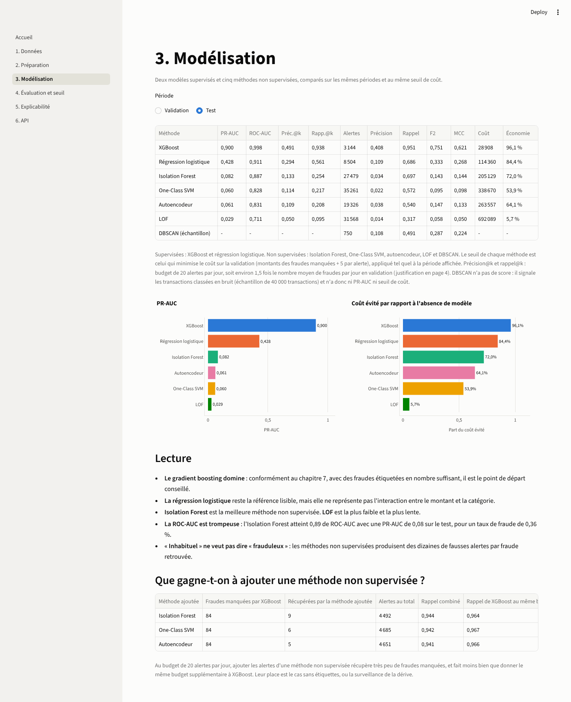
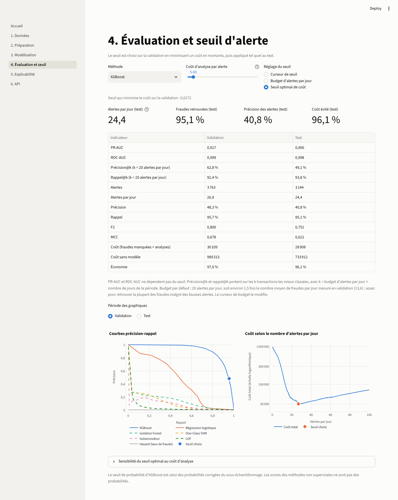
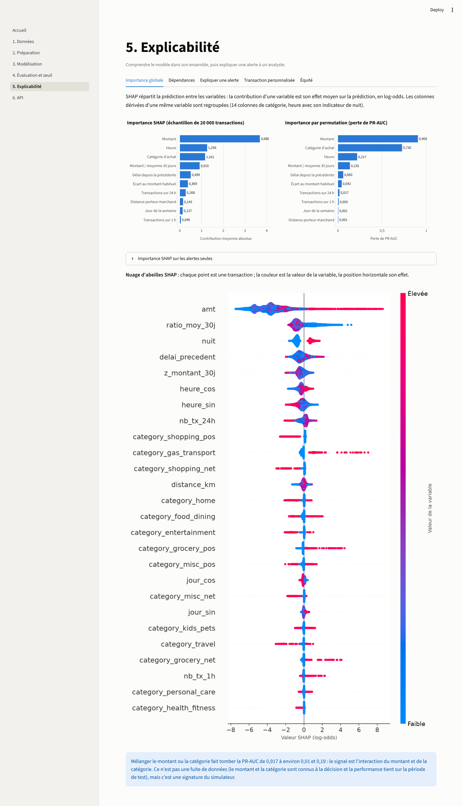
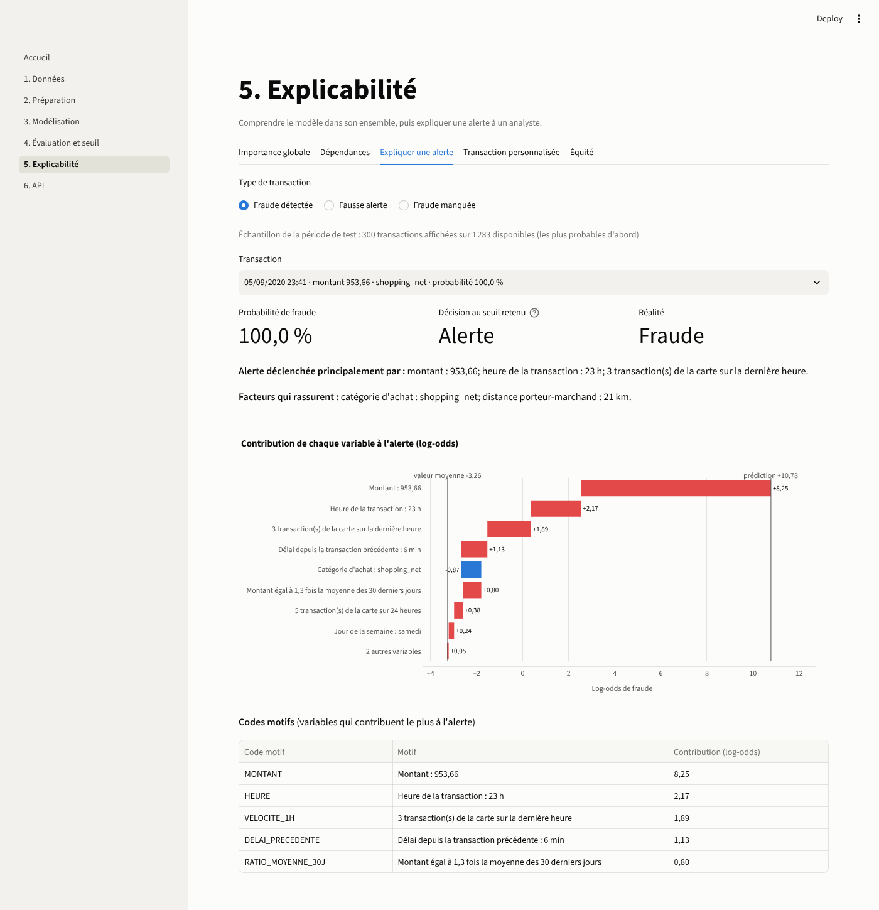
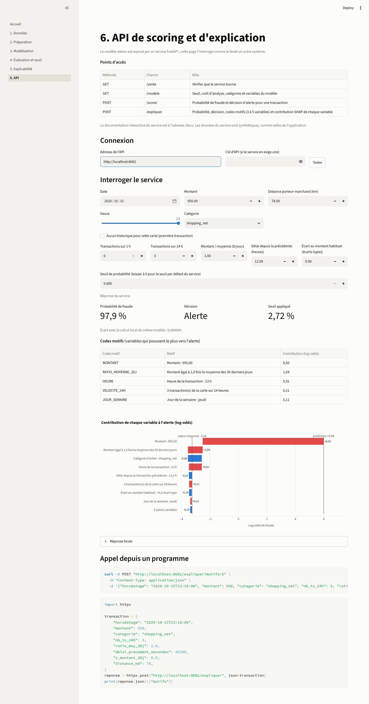

# Détection de fraude par carte bancaire explicable

Application web interactive, service d'API et analyses pour la détection de fraude sur des transactions par carte bancaire.
Projet du cours Data Mining pour la finance (ENSI, 2026-2027), Challenge 2.

Le projet classe les transactions par niveau de risque, signale les plus suspectes dans un budget d'alertes donné, fixe le seuil d'alerte à partir d'un coût exprimé en montants, et explique chaque alerte avec SHAP.

## Démonstration en ligne

- Application : https://detection-fraude-explicable.streamlit.app
- API (documentation interactive) : https://detection-fraude-api.onrender.com/docs

Les deux services sont gratuits et s'endorment après une période d'inactivité : la première ouverture, ou le premier appel de l'API, peut prendre une minute.

## Données

Simulateur Sparkov, jeu `kartik2112/fraud-detection` sur Kaggle (licence CC0) : 1 852 394 transactions de 999 cartes, du 1er janvier 2019 au 31 décembre 2020, dont 9 651 fraudes (0,52 %). Les fichiers `fraudTrain.csv` et `fraudTest.csv` sont rassemblés puis triés par date.

Les données sont synthétiques : les schémas de fraude sont ceux du simulateur et les performances ne se transposent pas telles quelles à des données réelles.

## Méthode en bref

- Découpage chronologique 60 % / 20 % / 20 % : validation du 7 avril au 25 août 2020, test du 25 août au 31 décembre 2020.
- Variables temporelles (heure et jour à codage cyclique, indicateur de nuit), variables comportementales calculées sur le seul passé de la carte (transactions sur 1 h et 24 h, montant rapporté à la moyenne sur 30 jours, délai depuis la transaction précédente, écart au profil), distance porteur-marchand.
- Déséquilibre : comparaison en validation de la pondération, du sous-échantillonnage à plusieurs rapports et de SMOTE, appliqués au seul entraînement. Retenu pour XGBoost : sous-échantillonnage 1:20, avec correction des probabilités.
- Modèles supervisés : régression logistique pondérée et XGBoost. Méthodes non supervisées : Isolation Forest, One-Class SVM, autoencodeur, LOF, DBSCAN.
- Budget d'alertes k : 20 par jour, soit environ 1,5 fois le nombre moyen de fraudes par jour en validation (13,6), pour retrouver la plupart des fraudes malgré des fausses alertes ; précision@k et rappel@k s'y rapportent.
- Seuil : minimisation, sur la validation, du coût (montants des fraudes manquées + 5 par alerte analysée), puis confirmation sur le test.
- Explicabilité : SHAP (global, local, dépendances), importance par permutation, codes motifs, comparaison selon le genre et l'âge.

## Résultats sur la période de test

Seuil choisi sur la validation (probabilité corrigée de 0,0272).

| Méthode | PR-AUC | ROC-AUC | Rappel | Précision | F2 | MCC | Coût |
|---|---|---|---|---|---|---|---|
| XGBoost | 0,900 | 0,998 | 0,951 | 0,408 | 0,751 | 0,621 | 28 908 |
| Régression logistique | 0,428 | 0,911 | 0,686 | 0,109 | 0,333 | 0,268 | 114 360 |
| Isolation Forest | 0,082 | 0,887 | 0,697 | 0,034 | 0,143 | 0,144 | 205 129 |
| One-Class SVM | 0,060 | 0,828 | 0,572 | 0,022 | 0,095 | 0,098 | 338 670 |
| Autoencodeur | 0,061 | 0,831 | 0,540 | 0,038 | 0,147 | 0,133 | 263 557 |
| LOF | 0,029 | 0,711 | 0,317 | 0,014 | 0,058 | 0,050 | 692 089 |

DBSCAN, qui ne produit pas de score, n'a ni PR-AUC ni courbe : il désigne des transactions isolées, avec une précision de 0,108 et un rappel de 0,491 sur le test.

Le coût sans modèle (toutes les fraudes manquées) est de 733 912 sur le test. Le détail, avec précision@k et rappel@k pour un budget de 20 alertes par jour, est dans `resultats/evaluation_comparative.csv`.

## Limites

- Le modèle s'appuie surtout sur le montant et la catégorie : c'est une signature du simulateur, dont les montants de fraude suivent des lois propres à chaque catégorie et sont plafonnés à 1 376.
- Âge et genre améliorent les mesures mais ne sont pas utilisés : l'âge identifie presque chaque porteur, et ce sont des caractéristiques protégées. Les alertes diffèrent pourtant entre hommes et femmes, par des variables corrélées.
- L'effet d'un écart au montant habituel élevé (z-score) est contraire à l'intuition et n'est pas expliqué à ce stade.
- La monnaie n'est pas précisée par la source.

## Captures de l'application

| | |
|---|---|
| Accueil |  |
| 1. Données |  |
| 2. Préparation |  |
| 3. Modélisation |  |
| 4. Évaluation et seuil |  |
| 5. Explicabilité, importance globale |  |
| 5. Explicabilité, explication d'une alerte |  |
| 6. API |  |

## Contenu du dépôt

| Dossier | Contenu |
|---|---|
| `src/` | Code de la chaîne complète : données, variables, préparation, déséquilibre, modèles, métriques, évaluation, explicabilité, équité |
| `app/` | Application Streamlit (accueil et six pages) et ressources précalculées |
| `api/` | Service FastAPI |
| `notebooks/` | Six carnets exécutés, un par étape |
| `resultats/` | Tableaux, paramètres retenus et figures produits par les scripts |
| `modeles/` | Modèles entraînés |
| `tests/` | Tests automatiques |
| `captures/` | Captures d'écran de l'application |
| `deploiement/` | Dépendances du service d'API pour l'hébergement (voir `render.yaml` à la racine) |

## Installation

Python 3.13 recommandé.

```
python -m venv .venv
.venv\Scripts\Activate.ps1
pip install -r requirements-dev.txt
```

Sous Linux ou macOS, activer l'environnement avec `source .venv/bin/activate`. Pour exécuter seulement l'application et l'API, `requirements.txt` suffit.

## Utilisation

Application :

```
python -m streamlit run app/Accueil.py
```

L'application fonctionne sans les données brutes : elle lit les ressources précalculées de `app/ressources/`.

API, dans un autre terminal :

```
python -m uvicorn api.principal:app --port 8000
```

La documentation interactive est sur http://localhost:8000/docs. Dans la page « 6. API » de l'application, saisir `http://localhost:8000` pour que les explications soient calculées par le service. Une clé d'API peut être exigée en définissant la variable d'environnement `CLE_API` avant de lancer le service ; elle est alors à fournir dans l'en-tête `X-API-Key`.

Exemple d'appel :

```
curl -X POST "http://localhost:8000/expliquer?motifs=5" -H "Content-Type: application/json" -d "{\"horodatage\": \"2020-10-15T23:10:00\", \"montant\": 950, \"categorie\": \"shopping_net\", \"nb_tx_24h\": 3, \"ratio_moy_30j\": 1.0, \"delai_precedent_secondes\": 43200, \"z_montant_30j\": 0.0, \"distance_km\": 78}"
```

Tests :

```
python -m pytest -q
```

## Reproduire les résultats

Le téléchargement des données se fait automatiquement avec `kagglehub` au premier chargement. Les étapes, dans l'ordre :

```
python -m src.lancer_desequilibre
python -m src.lancer_reglage
python -m src.lancer_modeles_supervises
python -m src.lancer_non_supervise
python -m src.lancer_evaluation
python -m src.lancer_explicabilite
python -m src.lancer_dependances
python -m src.lancer_equite
python -m src.lancer_ressources
python -m src.executer_carnets
```

Le réglage et les entraînements sont longs ; les résultats déjà produits sont versionnés dans `resultats/`, `modeles/` et `app/ressources/`.

## Déploiement

L'API se déploie sur Render à partir de `render.yaml` (service web Python, offre gratuite) : Nouveau, Blueprint, choix du dépôt. Un service gratuit s'endort après 15 minutes sans appel et met environ une minute à se réveiller. L'application se déploie sur Streamlit Community Cloud avec `app/Accueil.py` comme fichier principal ; l'adresse de l'API est donnée par la variable `URL_API`.

## Source des données

Jeu `kartik2112/fraud-detection` sur Kaggle, produit avec le simulateur Sparkov. Licence CC0 1.0.
